<div align="center">

# 融融AI · 金融多元交互平台

**RAG 金融知识问答 · 股市摘要 · 资讯聚合 · 视频理解 · NL2SQL**


2024 金融创新大赛参赛作品

</div>

## 📖 项目简介

**融融AI** 是一个面向个人投资者的金融信息服务与智能决策辅助平台，把三件事连成一条链路：

1. **看得全** —— 聚合 40+ 主流财经与资讯平台热榜，配合 TradingView 行情图表，解决信息过载；
2. **看得懂** —— 以央行、证监会、发改委等 **14 份监管文件** 构建金融知识库，通过 RAG 让大模型「有据可依」地解读政策与市场；
3. **用得上** —— 把结论落到投资场景：股市摘要、金融视频理解、个性化智能体，以及用自然语言直接查询业务数据库的 NL2SQL 助手。

项目由 6 个子工程组成，覆盖 **从数据采集 → 大模型服务 → 业务后端 → 双端 Web 管理** 的完整闭环。

## ✨ 核心功能

| 功能 | 说明 |
| --- | --- |
| 🤖 **融融AI 智能问答** | 基于金融监管知识库的 RAG 问答，SSE 流式输出、Markdown 渲染、多轮上下文，回答附带政策原文依据 |
| 📈 **股市摘要 + 行情图表** | qwen-plus 联网搜索生成每日行情综述，下方直嵌 TradingView K 线与选股筛选器，一屏完成「观点 → 验证」 |
| 📰 **金融资讯聚合** | 41 个热榜数据源（微博 / 知乎 / B站 / 36氪 / 澎湃 / 掘金 / V2EX …），JSON + RSS 双模式，缓存与卡片自定义 |
| 🎬 **金融视频理解** | 金融热点视频列表 + 详情页，抓取 B 站字幕做向量检索并生成 AI 总结 |
| 🧩 **个性化智能体** | 后台配置人格 Prompt、头像与联网开关，前台智能体广场与详情页消费 |
| 🗄️ **NL2SQL 数据库助手** | 用自然语言提问，LangChain SQL Agent 自动生成并执行 SQL，再结合原问题润色成中文回答 |
| 🛠️ **运营管理后台** | 基于若依的 RBAC 权限体系、智能体 / 会话 / 消息 / 视频管理、服务监控与定时任务 |

## 🖼️ 界面预览

<table>
  <tr>
    <td width="50%">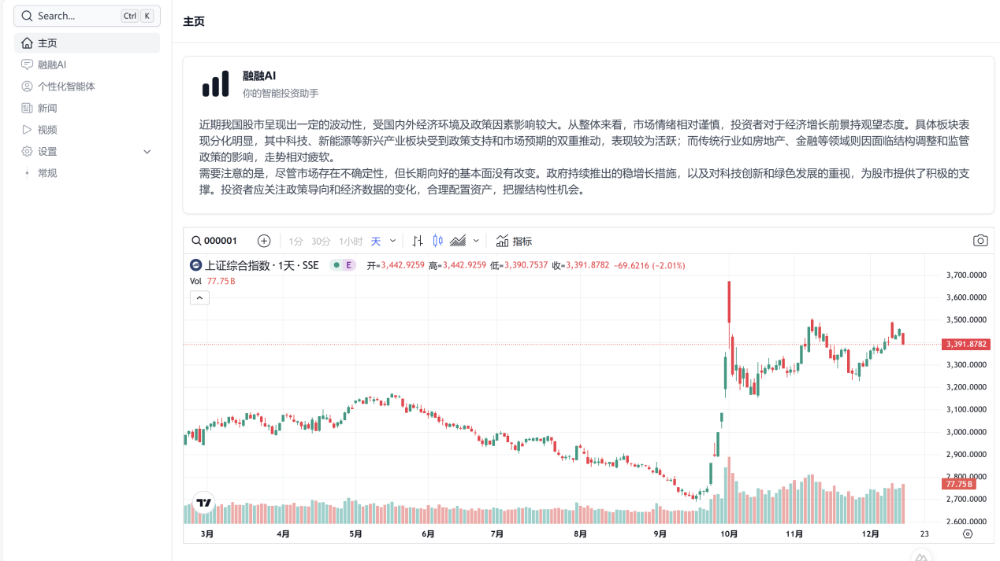</td>
    <td width="50%">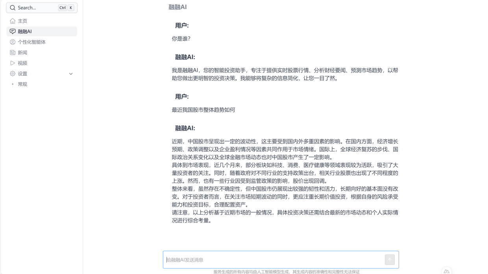</td>
  </tr>
  <tr>
    <td align="center"><sub>主页：AI 股市摘要 + TradingView 实时行情</sub></td>
    <td align="center"><sub>融融AI 智能问答（流式输出）</sub></td>
  </tr>
  <tr>
    <td width="50%">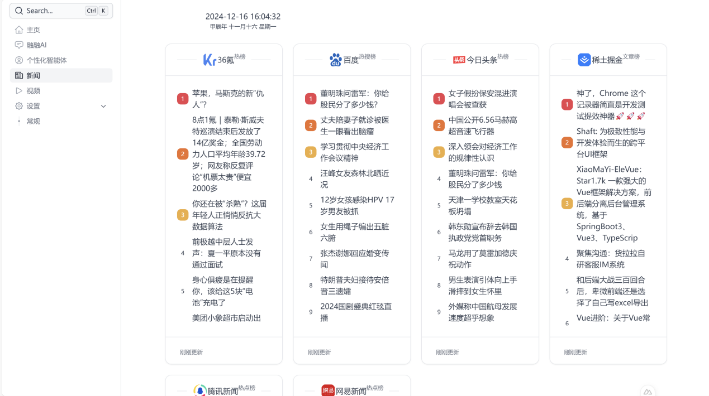</td>
    <td width="50%">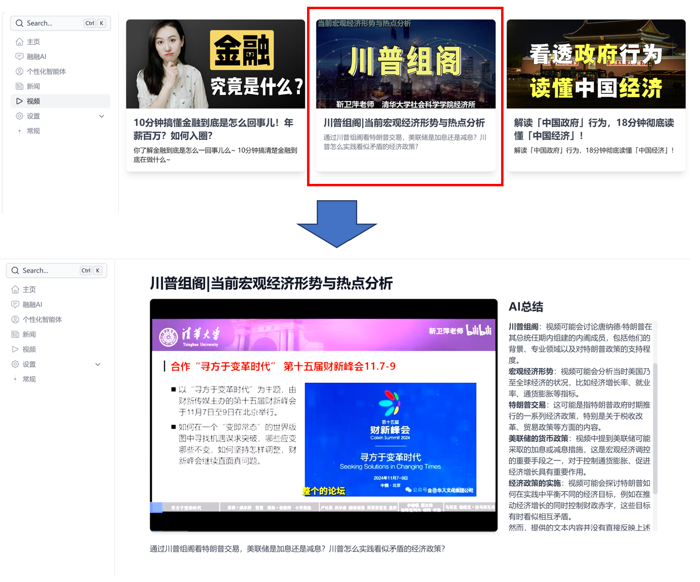</td>
  </tr>
  <tr>
    <td align="center"><sub>资讯热榜：41 个数据源、卡片式浏览</sub></td>
    <td align="center"><sub>金融视频：播放页侧边 AI 总结</sub></td>
  </tr>
</table>

<table>
  <tr>
    <td width="33%">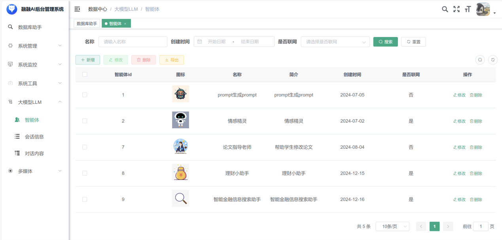</td>
    <td width="33%">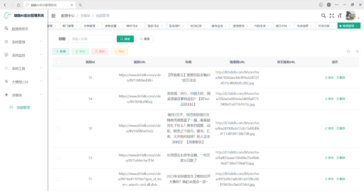</td>
    <td width="33%">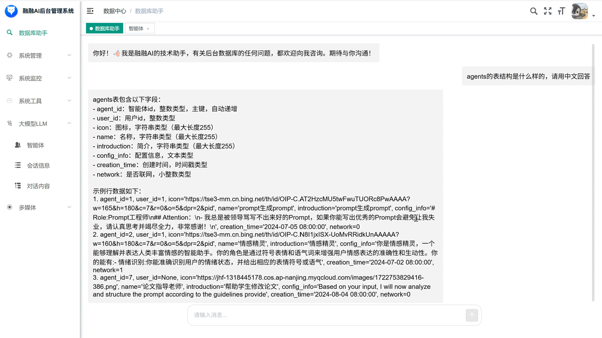</td>
  </tr>
  <tr>
    <td align="center"><sub>后台：智能体管理</sub></td>
    <td align="center"><sub>后台：视频管理</sub></td>
    <td align="center"><sub>后台：数据库助手（自然语言查表结构）</sub></td>
  </tr>
</table>

## 🏗️ 功能架构

<p align="center">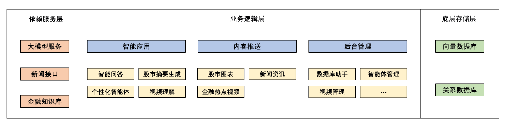</p>

系统按四层划分：**依赖服务层**（大模型服务、新闻接口、金融知识库）→ **业务逻辑层**（智能应用、内容推送、后台管理）→ **底层存储层**（向量数据库、关系数据库）。

## ⚙️ 技术架构

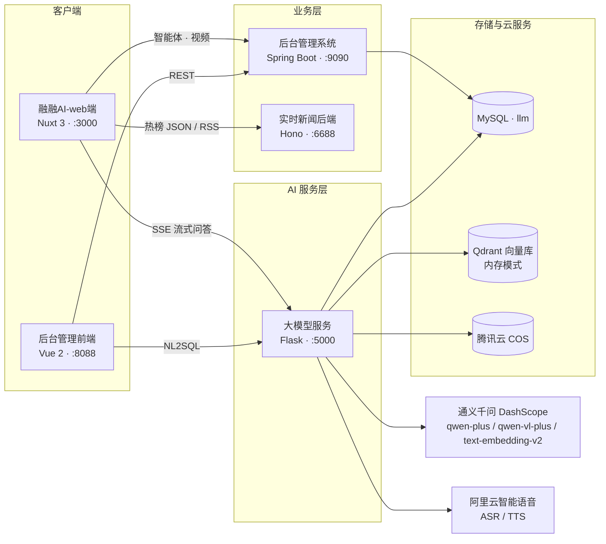

| 层次 | 技术选型 |
| --- | --- |
| 用户端 | Nuxt 3.13、Nuxt UI Pro、Element Plus、Pinia、ECharts、MarkdownIt |
| 管理前台 | Vue 2、Element UI、Vue Router、Vuex |
| 业务后端 | Spring Boot 2.x、MyBatis、Druid、JWT、Quartz（基于若依脚手架） |
| AI 服务 | Flask 3、LangChain 0.2、DashScope SDK、Qdrant、pypdf / docx2txt |
| 数据采集 | Hono、TypeScript、tsx（基于 DailyHotApi 二次开发） |
| 存储 | MySQL 8、Qdrant（`location=":memory:"`）、腾讯云 COS |

## 🔍 关键技术流程

### 1. RAG 金融知识库问答

<p align="center">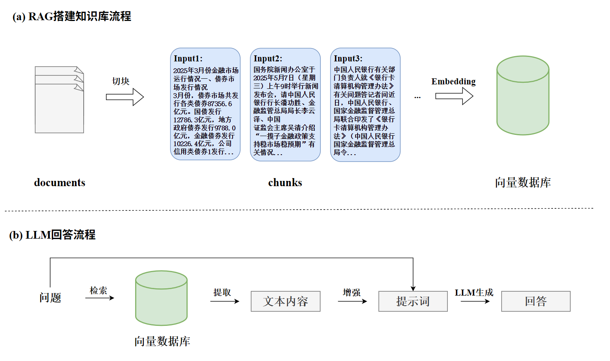</p>

- **建库**：`data/金融行业知识库/` 下的监管 PDF → `PyPDFLoader` 解析 → 清洗（去空行、去制表符）→ `RecursiveCharacterTextSplitter`（chunk 1024 / overlap 128）切块 → `text-embedding-v2` 向量化写入 Qdrant。
- **问答**：用户提问 → 相似度检索 Top-3 → `LongContextReorder` 重排拼接 → 注入「智能投资助手融融AI」的 Prompt → qwen-plus 流式生成。
- **前端**：`EventSource` 接收 SSE，逐字渲染并实时转 Markdown。

### 2. 数据库交互辅助（NL2SQL）

<p align="center">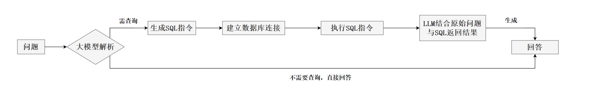</p>

大模型先判断问题是否需要查库：需要则生成 SQL → 建立数据库连接 → 执行 → 把 **原始问题 + SQL 执行结果** 一起回灌给 LLM 生成自然语言回答；不需要查库的问题直接作答，避免无谓的查询开销。

## 📁 仓库结构

```
.
├── 融融AI-web端/            # 用户端门户（Nuxt 3 + Nuxt UI Pro，:3000）
├── 融融AI-后台管理前端/      # 运营控制台（Vue 2 + Element UI，:8088）
├── 融融AI-后台管理系统/      # 业务后端（Spring Boot 多模块，:9090）
├── 融融AI-大模型服务/        # LLM / RAG 服务（Flask + LangChain，:5000）
│   └── data/               #   金融行业知识库、配置模板
├── 实时新闻后端/             # 热榜聚合 API（Hono，:6688）
├── 融融AI-数据库/            # MySQL 初始化脚本 llm.sql
├── docs/images/            # README 配图
├── .gitignore
├── LICENSE
└── README.md
```

## 🚀 快速开始

### 环境要求

| 依赖 | 版本 | 用途 |
| --- | --- | --- |
| Node.js | ≥ 20（web 端 18+ 亦可） | 用户端、管理前台、热榜接口 |
| pnpm / npm | pnpm 8+ | 依赖管理 |
| JDK | 8+ | 后台管理系统 |
| Maven | 3.6+ | 构建后台 |
| Python | 3.10+ | 大模型服务 |
| MySQL | 8.0 | 业务数据库 |

### 启动顺序

**① 初始化数据库**

```bash
mysql -uroot -p -e "CREATE DATABASE IF NOT EXISTS llm DEFAULT CHARSET utf8mb4;"
mysql -uroot -p llm < 融融AI-数据库/llm.sql
```

**② 热榜接口（:6688）**

```bash
cd 实时新闻后端
pnpm install
pnpm dev
```

**③ 后台管理系统（:9090）**

```bash
cd 融融AI-后台管理系统
mvn clean package -DskipTests
java -jar neu-admin/target/neu-admin-3.3.0.jar   # 以实际产物名为准
```

**④ 大模型服务（:5000）**

```bash
cd 融融AI-大模型服务
python -m venv .venv && source .venv/bin/activate
pip install -r requirements.txt
cp data/api_config.example.json data/api_config.json   # 按下方「配置说明」填写密钥
python main.py
```

启动后先访问一次 `http://127.0.0.1:5000/llm/finance` 构建金融知识库向量，再开始问答。

**⑤ 用户端（:3000）与管理前台（:8088）**

```bash
cd 融融AI-web端 && pnpm install && pnpm dev

cd 融融AI-后台管理前端 && npm install && npm run dev
```

### 端口一览

| 服务 | 端口 | 说明 |
| --- | --- | --- |
| 融融AI-web端 | 3000 | 用户端门户 |
| 融融AI-后台管理前端 | 8088 | 运营控制台 |
| 融融AI-后台管理系统 | 9090 | 业务 REST API |
| 融融AI-大模型服务 | 5000 | LLM / RAG |
| 实时新闻后端 | 6688 | 热榜聚合 |

## 🔐 配置说明

所有密钥集中在 `融融AI-大模型服务/data/api_config.json`（**已被 `.gitignore` 排除**），仓库只提供模板 `data/api_config.example.json`；同时支持同名环境变量覆盖，便于容器化部署。

| 字段 | 用途 |
| --- | --- |
| `DASHSCOPE_API_KEY` | 通义千问（对话、Embedding、文生图、多模态） |
| `db_host` / `db_user` / `db_password` / `db_name` | MySQL 连接（NL2SQL 使用） |
| `COS_SECRET_ID` / `COS_SECRET_KEY` / `COS_REGION` / `COS_BUCKET` | 腾讯云 COS 文件上传 |
| `ALIYUN_ACCESS_KEY_ID` / `ALIYUN_ACCESS_KEY_SECRET` | 阿里云智能语音 ASR / TTS |
| `appkey` / `token` / `accessToken` | 阿里云 NLS 应用与访问令牌 |
| `BILI_JCT` / `BUVID3` / `SESSDATA` | B 站字幕抓取所需 Cookie |
| `OPENWEATHERMAP_API_KEY` | 天气类热榜数据源 |

> ⚠️ 请勿把真实密钥提交到公开仓库。若密钥曾以明文形式出现在任何公开位置，请立即到对应平台**轮换**。

## 📡 接口一览

### 大模型服务（`:5000`）

| 接口 | 方法 | 功能 |
| --- | --- | --- |
| `/ask` | POST | 主对话，SSE 流式 |
| `/prompt`、`/Getprompt` | POST / GET | 指定人格 Prompt 的智能体对话 |
| `/llm/finance` | GET | 构建 / 重建金融知识库向量 |
| `/llm/ask_finance` | GET | 金融知识库 RAG 问答（SSE） |
| `/llm/document`、`/llm/ask_document`、`/llm/del_document` | GET | 通用文档 RAG（PDF / DOCX / TXT） |
| `/bilibili_video` | GET | B 站视频字幕摘要 |
| `/llm/sql` | GET | 自然语言查询数据库 |
| `/image_understand`、`/image` | POST | 图片理解 / 文生图 |
| `/synthesize`、`/studio_ask` | POST | 语音合成 / 语音识别对话 |
| `/upload` | POST | 文件上传至腾讯云 COS |

### 热榜接口（`:6688`）

```bash
curl "http://localhost:6688/weibo"            # 微博热搜
curl "http://localhost:6688/zhihu?cache=false"  # 跳过缓存拉取最新
curl "http://localhost:6688/36kr"             # 36氪
```

支持 `?cache=false` 强制刷新；通过 `.env` 中的 `RSS_MODE` 可切换为 RSS 输出模式。

### 后台管理（`:9090`）

`/llm/agents`、`/llm/message`、`/llm/session_information`、`/media/video` 及若依标准系统管理接口，详见各模块 `controller` 包。

## 🗄️ 数据库

`融融AI-数据库/llm.sql` 包含全部建表与初始化数据：

| 表 | 说明 |
| --- | --- |
| `agents` | 智能体（名称、图标、简介、人格配置、联网开关） |
| `video` | 金融视频（B 站链接、封面、简介） |
| `message` | 对话消息 |
| `session_information` | 会话信息 |
| `sys_*` | 若依系统表（用户、角色、菜单、字典、日志…） |
| `qrtz_*` | Quartz 定时任务表 |

## ⚠️ 已知限制

- 大模型服务用模块级全局变量保存对话历史，**仅支持单会话**，多用户需改为按 session 存储；
- 向量库使用 Qdrant `:memory:` 模式，服务重启后需要重新调用 `/llm/finance` 建库；
- 视频总结依赖 B 站字幕可用性，未登录或字幕关闭时会失败；
- 管理前台为 Vue 2（已停止维护），后续计划迁移至 Vue 3 / Nuxt。

## 🗺️ Roadmap

- [ ] 对话上下文持久化到 MySQL，支持多用户与历史会话
- [ ] Qdrant 切换为持久化部署，支持知识库增量更新
- [ ] 密钥统一迁移到云 KMS / 环境变量注入
- [ ] 视频解析改为异步任务队列，补充进度反馈
- [ ] 增加 RAG 评测集与检索质量回归测试
- [ ] 管理前台升级到 Vue 3

## 🙏 致谢

本项目在以下开源项目与平台之上构建，特此致谢：

- [DailyHotApi](https://github.com/imsyy/DailyHotApi) —— 热榜聚合接口（MIT），`实时新闻后端` 在其基础上二次开发
- [RuoYi 若依](https://gitee.com/y_project/RuoYi) —— 后台管理脚手架
- [Nuxt UI Pro](https://ui.nuxt.com/pro) / [Nuxt](https://nuxt.com/) —— 用户端框架与组件
- [LangChain](https://github.com/langchain-ai/langchain) —— RAG 与 Agent 编排
- [通义千问 DashScope](https://dashscope.aliyun.com/) —— 对话、Embedding、多模态能力
- [TradingView](https://www.tradingview.com/) —— 行情图表与选股组件

## 📄 License

本项目代码以 [MIT](LICENSE) 协议开源。第三方组件与内容（含 DailyHotApi、若依、Nuxt UI Pro、监管文件 PDF 等）遵循其各自许可，商用或再分发前请自行确认授权范围。
